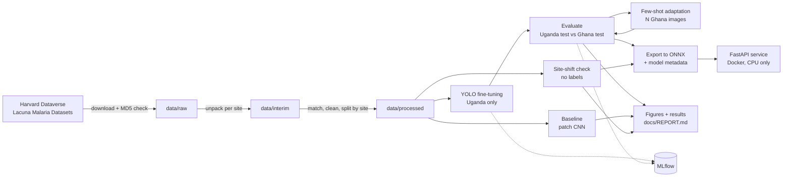

# Malaria parasite detection that holds up across clinics

MSc Data Science & Analytics capstone, Health informatics track (disease image classification).

A model that finds malaria parasites in thick blood-smear photos is usually tested on images from
the lab it was trained in. This project trains a detector on photos from **Uganda** and tests it on
photos from **Ghana**, a site it has never seen, to measure how much accuracy survives the move and
how many locally labelled images it takes to recover. The trained model is served by a small API
that runs on a laptop CPU.

> **Status.** The code runs end to end and is covered by tests and a synthetic-data smoke run.
> Results on the real dataset appear in `docs/REPORT.md` and `reports/` once you run the pipeline;
> nothing in this repository claims a real-data result until then.

## Architecture



| Path | What it holds |
| --- | --- |
| `params.yaml` | Every setting: dataset, classes, split, training, evaluation |
| `malaria/data/` | `download`, `unpack`, `prepare` (cleaning + site split), `synthetic` (smoke data) |
| `malaria/models/` | `baseline`, `train`, `evaluate`, `adapt`, `export` |
| `malaria/evalcore.py` | Detection metrics in NumPy (AP, operating point, bootstrap), unit-tested |
| `malaria/shift.py` | Label-free comparison of the two sites' images |
| `malaria/report.py` | Figures and result tables |
| `malaria/pipeline.py` | Runs all stages with one command |
| `service/` | FastAPI app, ONNX Runtime inference, demo page |
| `models/` | Trained weights, `model.onnx`, `model_meta.json` (written by the pipeline) |
| `reports/` | Data report, metrics, figures (written by the pipeline) |
| `docs/REPORT.md` | Final report; the results block is refreshed by the pipeline |
| `tests/` | Unit tests for data handling, metrics and the API |

## Setup

Requirements: Python 3.10 or newer (developed on 3.13), about 25 GB of free disk for the real dataset, a tool that opens
RAR archives ([7-Zip](https://www.7-zip.org) on Windows, `unrar` or `bsdtar` elsewhere), and Docker
for serving. Training wants a GPU; everything else runs on a CPU.

```bash
python -m venv .venv
# Windows: .venv\Scripts\activate        Linux/macOS: source .venv/bin/activate
pip install -r requirements.txt
```

On a GPU machine, install the PyTorch build for your CUDA version first
(see https://pytorch.org/get-started/locally/), then run the line above.

## Check that everything works (about 5 minutes, CPU)

```bash
python -m pytest -q                      # unit tests
python -m malaria.pipeline --smoke       # every stage, on tiny synthetic images
```

The smoke run draws coloured blobs for two fake "sites" and pushes them through every stage. It
writes only under `data_smoke/`. Its numbers mean nothing; it proves the pipeline is wired correctly.

## Reproduce the real results

```bash
python -m malaria.pipeline            # first run
python -m malaria.pipeline --fresh    # start again: deletes prepared data, models, runs, reports and MLflow history, keeps the downloads
```

That one command runs these stages in order. Each can be run alone
(`python -m malaria.pipeline --only prepare`) or resumed from (`--from train`); finished work is kept.

| Stage | What happens | Output |
| --- | --- | --- |
| `download` | Lists the Dataverse record through its API, downloads the Ghana thick-smear files with resume, checks each MD5 | `data/raw/` |
| `unpack` | Extracts archives into one folder per site | `data/interim/` |
| `prepare` | Matches images to annotations, drops and counts unusable images, maps labels, splits by site | `data/processed/`, `reports/data_report.md` |
| `shift` | Compares simple image statistics between sites | `reports/metrics/shift.json` |
| `baseline` | Trains the patch CNN on Uganda, scores both sites | `reports/metrics/baseline.json` |
| `train` | Fine-tunes YOLO on Uganda, one run per variant in `params.yaml` (`base`, `stain_aug`, `scale_aug`) | `models/<variant>.pt` |
| `evaluate` | Scores every model on Uganda test and Ghana test, also at a 2048-pixel input; Ghana results both at the Uganda threshold and at a threshold chosen on the Ghana calibration set; picks the served model on Uganda validation | `reports/metrics/detection.json` |
| `adapt` | Fine-tunes the selected model on 50, 100 and 200 Ghana images, plain and with Uganda replay | `models/adapt_*.pt` |
| `evaluate_adapted` | Re-scores with the adapted models included | same file |
| `export` | Exports the selected model to ONNX, checks it agrees with the PyTorch model, copies demo photos | `models/model.onnx`, `models/model_meta.json`, `samples/` |
| `report` | Draws figures, writes result tables, refreshes `docs/REPORT.md` | `reports/` |

### The Uganda images come from Zindi, not Dataverse

The Dataverse record holds the Ghana thick-smear images and the thin-smear images only. The Uganda
thick-smear images were released through the
[Lacuna Malaria Detection Challenge](https://zindi.world/competitions/lacuna-malaria-detection-challenge/data)
on Zindi (CC BY-SA 4.0; a free Zindi account is needed, and the rules allow research use). Download
the image archive and `Train.csv` from the challenge's Data page and put them in `data/raw/` with
`uganda` in their names, for example:

```
data/raw/Thick_Uganda_zindi_images.zip
data/raw/Thick_Uganda_zindi_Train.csv
```

Then run `python -m malaria.pipeline --from unpack`. The challenge's `Test.csv` images have no public
labels; they are counted as "no annotation" and excluded.

**After `prepare`, read `reports/data_report.md` before training.** It shows which annotation format
was found, how many images were excluded and why, any label spellings that were not recognised, and
sample file names. Two settings may need a one-line change in `params.yaml`:

- `classes.aliases`: add any unrecognised label that should count as a parasite or a white cell.
- `split.group_regex`: if file names contain a slide id, set a pattern that captures it so that
  images of one slide never land in both training and test.

If the download cannot run on your network, download the thick-smear files by hand from
<https://doi.org/10.7910/DVN/VEADSE> into `data/raw/` and start with `--from unpack`.

Runtime on the machine used for the reported results: _fill in after your run (hardware, hours per stage)_.

### Train on one machine, present on another

Training produces small files. After the run, commit `models/` (weights, `model.onnx`,
`model_meta.json`), `reports/` and `samples/`. On the laptop, pull the repository and go straight to
"Serve the model". No GPU and no dataset are needed there. If a weights file is over 100 MB, track
`models/*.pt` with Git LFS.

Experiment tracking: `mlflow ui --backend-store-uri sqlite:///mlflow.db`, then open <http://localhost:5000>.

## Serve the model

```bash
docker compose up --build
```

Then open <http://malaria-detector.localhost> for the demo page, or
<http://malaria-detector.localhost/docs> for the API docs. Browsers treat any name ending in
`.localhost` as your own computer, so this needs no setup. The app also answers at
<http://localhost:8000>, which is the address to use if another program already uses port 80.

```bash
curl -F "file=@samples/<a sample photo>.jpg" http://localhost:8000/predict
```

On Windows PowerShell use `curl.exe` in place of `curl`.

```json
{
  "image": {"width": 2048, "height": 2048},
  "detections": [{"label": "trophozoite", "confidence": 0.91, "box": [512.0, 640.5, 548.2, 677.0]}],
  "counts": {"trophozoite": 1, "wbc": 0},
  "parasites_per_wbc": null,
  "low_confidence": false,
  "low_confidence_reasons": [],
  "threshold": 0.3,
  "model": {"name": "base", "trained_on": "uganda", "imgsz": 1024, "exported": "2026-10-11"}
}
```

The example above shows the shape of the response; the values are illustrative.

| Endpoint | Purpose |
| --- | --- |
| `GET /health` | `ok` when a model is loaded, `no_model` with the reason otherwise |
| `GET /model` | Model metadata: classes, threshold, training site, test scores |
| `POST /predict` | Image in, detections and counts out. Optional `?conf=0.5` overrides the threshold |
| `POST /predict/annotated` | Same, but returns the photo with boxes drawn |
| `GET /` | Demo page |

`low_confidence` is raised when a parasite detection sits close to the threshold, or when the
photo's brightness, sharpness or colour falls outside the range seen at the training site.

Without Docker: `uvicorn service.app:app --port 8000`.

## How the evaluation stays honest

- The Ghana test set is never used for training, threshold choice or model choice.
- Ghana is split three ways that never overlap: test, adaptation pool, and a calibration set used only to choose a Ghana threshold.
- Ghana results are reported at the Uganda threshold (as shipped) and at the Ghana-calibrated threshold.
- The served model is chosen on Uganda validation data.
- Photos with a phone rotation flag are rotated upright before use, so pixels and labels share one frame.
- Exact duplicate images are removed before splitting, across sites as well as within them.
- Every exclusion is counted in `reports/data_report.md`.
- Scores come with 95% bootstrap intervals over images.
- Metrics are computed by `malaria/evalcore.py`, which has its own unit tests.

## Limits

- This is a course project and a decision-support prototype. It is not a diagnostic device and has
  had no clinical validation.
- Two sites cannot show how the model behaves at a third.
- Labels come from the dataset's annotators; about a fifth of the Uganda thick-smear images have no
  labels and are excluded.

## Credits and licences

- Ghana data: Makerere AI Lab and minoHealth AI Labs, *Lacuna Malaria Datasets*, Harvard Dataverse,
  <https://doi.org/10.7910/DVN/VEADSE>, CC BY 4.0.
- Uganda data: Makerere AI Health Lab, *Lacuna Malaria Detection Challenge*, Zindi,
  <https://zindi.world/competitions/lacuna-malaria-detection-challenge>, CC BY-SA 4.0.
- Sample photos in `samples/` come from these datasets.
- Detector: [Ultralytics YOLO](https://github.com/ultralytics/ultralytics), AGPL-3.0. Code that
  imports it is subject to that licence if the repository is made public.
- AI assistance is disclosed in [`AI_USE.md`](AI_USE.md).
