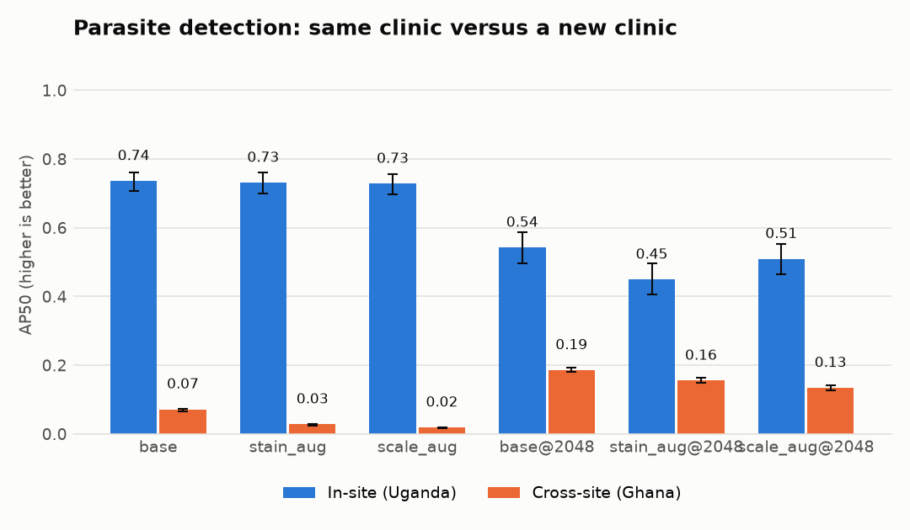
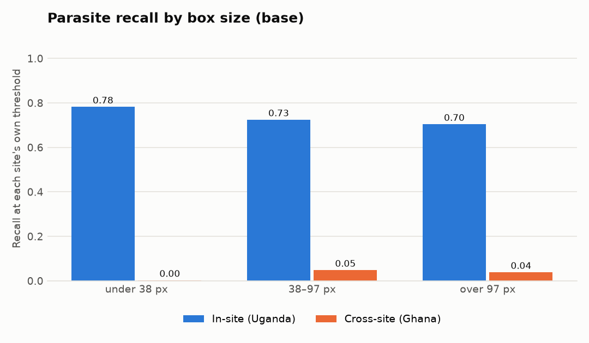
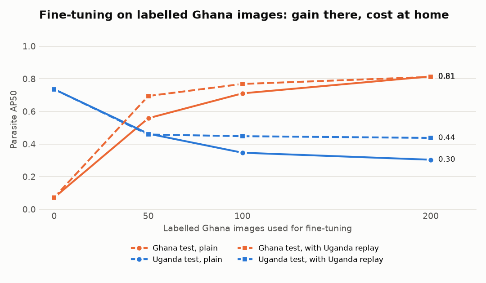
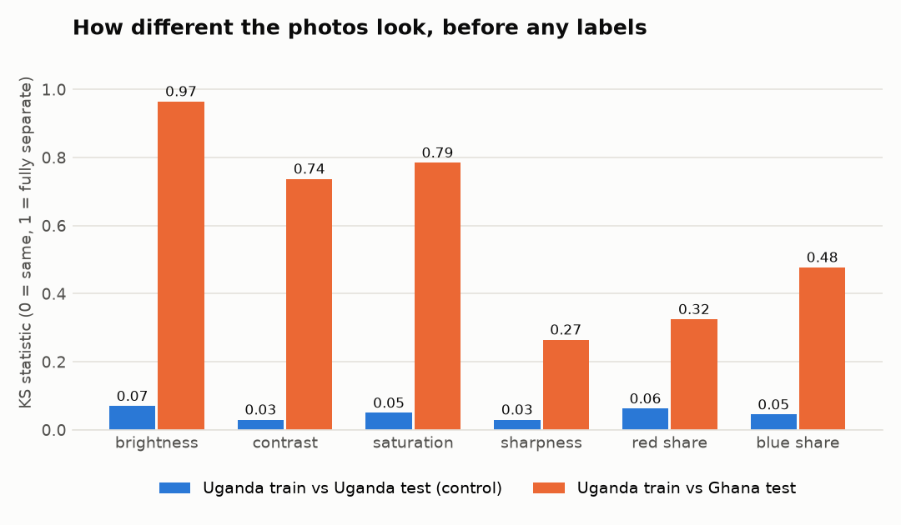

# Malaria parasite detection that holds up across clinics

Final report. MSc Data Science & Analytics capstone, Health informatics track.

## 1. Problem

Microscopy of stained blood smears is the standard way to confirm malaria, and reading slides
takes trained staff that many health centres are short of. A model that marks and counts parasites
in a phone photo taken through the microscope could support those centres.

Most published models are tested on images from the same laboratory that supplied their training
data. A different clinic uses a different microscope, phone, stain batch and slide preparation.
A model can lose accuracy there without anyone noticing, because the people using it have no labels
to check it against.

This project therefore asks three questions:

1. How well can parasites be detected in thick-smear photos from the site the model was trained on?
2. How much of that accuracy survives on photos from a site it has never seen?
3. Why is accuracy lost: the colour of the stain, or the size of the parasites in the photo?
4. How many labelled photos from the new site does it take to recover the loss, what does adapting
   cost at the original site, and can the change of site be noticed before any labels exist?

The output is a detector that returns boxes and counts for parasites (trophozoites) and white blood
cells, served through an API that runs on a laptop CPU. It is a support tool for a trained reader.

## 2. Data

**Source.** Two releases of the Lacuna Fund malaria imaging project, both of photos taken with a
smartphone mounted on a microscope eyepiece and annotated with bounding boxes around parasites and
white blood cells:

- Ghana thick smears: minoHealth AI Labs with Makerere AI Lab, *Lacuna Malaria Datasets*, Harvard
  Dataverse (CC BY 4.0), 3,000 images.
- Uganda thick smears: Makerere AI Health Lab, released as the *Lacuna Malaria Detection Challenge*
  on Zindi (CC BY-SA 4.0), 2,747 labelled training images; the challenge's test images have no
  public labels and are not used.

This project uses thick-smear images only. The two sets were annotated by different teams with
different tools, which is part of what "a different clinic" means here.

**Why this is not a clean benchmark.** The data arrives as multi-gigabyte multi-part archives of
field photographs. Some images have no annotations. Focus, lighting, stain colour and camera vary
between images and between the two countries. Parasites are small relative to the frame and
resemble stain debris.

**The complication introduced on purpose.** The split is by collection site, not at random. All
training, validation, threshold selection and model selection use Uganda. Ghana is held out as an
unseen-site test set. A random split would mix the two sites and hide the effect under study.

**Cleaning, all scripted in `malaria/data/prepare.py`.**

- Images are matched to annotations by file name. Images with no annotation are excluded, because
  an unlabelled image cannot be told apart from a parasite-free one.
- Unreadable images and exact duplicates (by file checksum, within and across sites) are removed.
- Label spellings are mapped to two classes. Labels that are not recognised are counted and
  reported, not silently dropped.
- Boxes are clipped to the image; boxes thinner than 2 pixels are removed.
- Photos that carry a phone rotation flag (2,445 of the Ghana images) are rotated upright once, so
  that the pixels and the labels use the same frame.
- Uganda is split into train, validation and in-site test. Ghana is split three ways that never
  overlap: the cross-site test set; a pool of 200 images for the adaptation experiment; and a
  calibration set of 100 images used only to choose a decision threshold for Ghana.

Counts for every step are in `reports/data_report.md` and in the first table of Section 5.

## 3. Method

**Pipeline.** One command, `python -m malaria.pipeline`, runs download, checksum verification,
unpacking, cleaning and splitting, training, evaluation, adaptation, export and reporting. All
settings live in `params.yaml`. Runs are logged to MLflow.

**Baseline.** A small three-block CNN classifies 48-pixel crops as parasite or not. Negatives are
random background crops and white-blood-cell crops. It answers a narrower question than the
detector and sets a floor.

**Main model.** A YOLO11 detector, pretrained on COCO, fine-tuned on Uganda at 1024-pixel input.
Three training runs differ in one augmentation setting each, and each tests one explanation for a
loss of accuracy at a new site:

- `base`: the library defaults.
- `stain_aug`: much stronger random changes of hue, saturation and brightness. If stain and camera
  colour cause the loss, this should reduce it.
- `scale_aug`: much stronger random zoom (0.1x to 1.9x, against 0.5x to 1.5x by default). If the
  size of the parasites in the photo causes the loss, this should reduce it.

**A second test of the size explanation, with no retraining.** Each trained model is also run at a
2048-pixel input, which doubles the size of every parasite as the model sees it. If tiny parasites
are the problem, this should help on Ghana.

**Evaluation protocol.**

- A detection is correct when it overlaps a labelled box of the same class with IoU of at least 0.5.
- Headline metric: average precision at IoU 0.5 (AP50) for the parasite class. Also reported:
  AP averaged over IoU 0.5 to 0.95, precision, recall and F1 at a fixed threshold, the share of
  parasite-containing images in which at least one parasite is found, and the error in the
  per-image parasite count.
- A detector outputs a confidence score per box; a threshold turns scores into decisions. Each
  model's "home" threshold maximises F1 on Uganda validation. Ghana results are reported twice:
  **as shipped**, at the home threshold, which is what a clinic gets with no labels; and
  **recalibrated**, at a threshold chosen the same way on the Ghana calibration set. AP50 ranks
  detections across all thresholds, so it is the same in both; precision, recall, F1 and count
  error change. This separates two failures: a model that ranks parasites badly, and a model that
  ranks them well but whose scores mean something different at the new site.
- The model to serve is chosen on Uganda validation.
- Every score has a 95% bootstrap interval from resampling images.
- Error analysis: recall by parasite box size, the share of false alarms that fall on white blood
  cells, and the images with the most errors, saved with boxes drawn.

**Adaptation.** The selected model is fine-tuned for a fixed number of epochs on 50, 100 and 200
labelled Ghana images from the adaptation pool, in two ways:

- **plain**: Ghana images only;
- **replay**: the same Ghana images plus the same number of Uganda training images, the standard
  remedy for a model forgetting what it learned before ("catastrophic forgetting").

Each adapted model is scored on the Ghana test set at its recalibrated threshold, and on the Uganda
test set at its home threshold, to see what is gained at the new site and what is lost at the old one.

**Noticing the shift without labels.** Six simple statistics are computed per photo (brightness,
contrast, saturation, sharpness, red share, blue share). The two sites are compared with a
Kolmogorov-Smirnov statistic per feature and with a classifier trained to tell the sites apart.
The same comparison between two Uganda splits serves as a control. The Uganda range of each
statistic is stored with the model, and the API flags uploads that fall outside it.

**Serving.** The selected model is exported to ONNX and served by FastAPI with ONNX Runtime in a
CPU-only Docker image. The export step checks that the served model counts the same objects as the
evaluated one.

## 4. Why these techniques, and why not others

| Choice | Reason |
| --- | --- |
| Object detection, not whole-image classification | The clinical quantity is a parasite count, and a technician can check a box. A positive/negative label per image gives neither. |
| Transfer learning from a pretrained detector | A few thousand labelled images are too few to train a detector from scratch. |
| A one-stage YOLO model | It handles many small objects per image, trains in hours on one GPU, and exports to a format that runs on a CPU. |
| A patch-CNN baseline | It shows what a simple model achieves, and whether a simple model loses accuracy across sites in the same way. |
| Site-based split | It is the only split that answers the question. |
| Colour and zoom augmentation as separate runs | Each run changes one thing, so a difference in the result can be attributed to colour or to size. Neither needs new labels. |
| Larger input at test time | A direct check of the size explanation that costs no training. |
| A separate calibration set for the new site | Choosing a threshold on the test set would inflate the results; choosing it at home hides a failure that is easy to fix. |
| Few-shot fine-tuning | It measures the real cost of bringing the model to a new clinic, in labelled images. |
| Replay during fine-tuning | It is the simplest way to keep the old site's performance, and it needs no change to the model. |
| Bootstrap intervals | Test sets of a few hundred images give noisy scores; a difference inside the interval is not a finding. |

| Ruled out | Reason |
| --- | --- |
| Vision transformers trained from scratch | Too little data. |
| Two-stage detectors (Faster R-CNN) | Slower to train and to serve on CPU, with no expected gain for this size of problem. Not tested here. |
| Segmentation models | The dataset has boxes, not masks. |
| Generative AI and LLM methods | No part of the task is language or generation; small-object localisation is a detection problem. |
| Stain normalisation as preprocessing | A reasonable alternative to colour augmentation. Left as future work to keep the comparison to one variable. |
| Tiling large photos into crops | Another way to keep small parasites large enough to see. The larger-input test answers the same question more cheaply. |
| Unsupervised domain adaptation | Promising for this problem, but it adds a research-scale component; the few-shot experiment gives a practical answer first. |
| Automated diagnosis | Out of scope. The system counts candidate parasites for a trained reader. |

## 5. Results

The block below is written by `python -m malaria.report` from the files in `reports/metrics/`.
Do not edit it by hand; re-run the stage.

<!-- RESULTS:START -->
### Data after cleaning

| Site | Images found | No annotation | Duplicates | Unreadable | Usable | Parasite boxes | WBC boxes |
| --- | ---: | ---: | ---: | ---: | ---: | ---: | ---: |
| uganda | 3925 | 1178 | 0 | 0 | 2747 | 15837 | 7004 |
| ghana | 3045 | 0 | 0 | 0 | 3045 | 360880 | 16174 |

Split sizes: uganda_train 1921, uganda_val 413, uganda_test 413, ghana_test 2745, ghana_adapt_pool 200, ghana_calib 100, ghana_adapt_50 50, ghana_adapt_50_replay 100, ghana_adapt_100 100, ghana_adapt_100_replay 200, ghana_adapt_200 200, ghana_adapt_200_replay 400.

### Parasite detection, in-site and cross-site

A detection counts when it overlaps a labelled box by IoU ≥ 0.5. Intervals are 95% bootstrap intervals over images. The model selected on `uganda_val` is **base**.

- **As shipped**: threshold chosen on `uganda_val`, what a new clinic gets with no labels.
- **Recalibrated**: threshold chosen on `ghana_calib`, labelled ghana images that are never trained on and never in the test set. AP does not depend on the threshold; the other columns do.
- `name@size` is the same trained model run at a larger input size, with no retraining.

| Model | Test set | Threshold | AP50 (95% interval) | AP50-95 | Precision | Recall | F1 | Image sensitivity | Count error (MAE) |
| --- | --- | ---: | --- | ---: | ---: | ---: | ---: | ---: | ---: |
| base | uganda | 0.29 | 0.736 (0.71 to 0.76) | 0.290 | 0.670 | 0.738 | 0.702 | 0.971 | 1.95 |
| base | ghana, as shipped | 0.29 | 0.072 (0.07 to 0.07) | 0.019 | 0.763 | 0.001 | 0.002 | 0.074 | 119.03 |
| base | ghana, recalibrated | 0.01 | 0.072 (0.07 to 0.07) | 0.019 | 0.554 | 0.046 | 0.085 | 0.612 | 109.26 |
| stain_aug | uganda | 0.29 | 0.731 (0.70 to 0.76) | 0.292 | 0.648 | 0.746 | 0.694 | 0.974 | 2.26 |
| stain_aug | ghana, as shipped | 0.29 | 0.028 (0.02 to 0.03) | 0.008 | 0.756 | 0.000 | 0.001 | 0.029 | 119.10 |
| stain_aug | ghana, recalibrated | 0.01 | 0.028 (0.02 to 0.03) | 0.008 | 0.413 | 0.018 | 0.034 | 0.475 | 114.06 |
| scale_aug | uganda | 0.26 | 0.728 (0.70 to 0.76) | 0.289 | 0.650 | 0.745 | 0.694 | 0.981 | 2.31 |
| scale_aug | ghana, as shipped | 0.26 | 0.019 (0.02 to 0.02) | 0.010 | 0.494 | 0.000 | 0.001 | 0.039 | 119.04 |
| scale_aug | ghana, recalibrated | 0.01 | 0.019 (0.02 to 0.02) | 0.010 | 0.345 | 0.012 | 0.023 | 0.327 | 115.05 |
| base@2048 | uganda | 0.18 | 0.542 (0.50 to 0.59) | 0.176 | 0.543 | 0.572 | 0.557 | 0.961 | 2.78 |
| base@2048 | ghana, as shipped | 0.18 | 0.186 (0.18 to 0.19) | 0.060 | 0.826 | 0.014 | 0.028 | 0.361 | 117.13 |
| base@2048 | ghana, recalibrated | 0.01 | 0.186 (0.18 to 0.19) | 0.060 | 0.712 | 0.113 | 0.195 | 0.851 | 100.28 |
| stain_aug@2048 | uganda | 0.18 | 0.449 (0.41 to 0.50) | 0.133 | 0.459 | 0.566 | 0.507 | 0.977 | 3.08 |
| stain_aug@2048 | ghana, as shipped | 0.18 | 0.155 (0.15 to 0.16) | 0.044 | 0.780 | 0.013 | 0.025 | 0.332 | 117.23 |
| stain_aug@2048 | ghana, recalibrated | 0.01 | 0.155 (0.15 to 0.16) | 0.044 | 0.633 | 0.111 | 0.190 | 0.767 | 98.19 |
| scale_aug@2048 | uganda | 0.22 | 0.509 (0.46 to 0.55) | 0.157 | 0.528 | 0.562 | 0.544 | 0.936 | 2.76 |
| scale_aug@2048 | ghana, as shipped | 0.22 | 0.134 (0.13 to 0.14) | 0.037 | 0.707 | 0.019 | 0.036 | 0.295 | 116.03 |
| scale_aug@2048 | ghana, recalibrated | 0.01 | 0.134 (0.13 to 0.14) | 0.037 | 0.526 | 0.130 | 0.209 | 0.708 | 94.47 |

For base, AP50 goes from 0.736 in-site to 0.072 cross-site, a relative change of -90.3%.

### White blood cells and error analysis

For base. Ghana rows use the recalibrated threshold where one exists.

| Test set | WBC AP50 | WBC recall | Parasite false positives | of which on a labelled WBC |
| --- | ---: | ---: | ---: | ---: |
| uganda | 0.973 | 0.968 | 942 | 0 |
| ghana | 0.634 | 0.540 | 12107 | 31 |

The images with the most errors for base are saved in `reports/figures/errors/` (12 for uganda_test, 12 for ghana_test). Green = correct detection, red = false alarm, yellow = missed parasite.

### Few-shot adaptation to the new site

Ghana columns use each model's recalibrated threshold; Uganda columns use its home threshold. Replay mixes in the same number of Uganda training images.

| Labelled ghana images | Mode | ghana AP50 | ghana precision | ghana recall | ghana image sensitivity | ghana count error | uganda AP50 | uganda recall |
| ---: | --- | ---: | ---: | ---: | ---: | ---: | ---: | ---: |
| 0 | none | 0.072 | 0.554 | 0.046 | 0.612 | 109.3 | 0.736 | 0.738 |
| 50 | plain | 0.558 | 0.549 | 0.617 | 0.993 | 49.4 | 0.463 | 0.539 |
| 100 | plain | 0.711 | 0.654 | 0.731 | 1.000 | 27.1 | 0.347 | 0.443 |
| 200 | plain | 0.815 | 0.726 | 0.802 | 1.000 | 23.5 | 0.304 | 0.417 |
| 50 | replay | 0.695 | 0.617 | 0.726 | 0.999 | 40.0 | 0.458 | 0.458 |
| 100 | replay | 0.768 | 0.667 | 0.776 | 1.000 | 36.5 | 0.448 | 0.510 |
| 200 | replay | 0.811 | 0.705 | 0.810 | 0.999 | 28.5 | 0.438 | 0.473 |

### Baseline: patch classifier

Patch-level scores for a small CNN. They are not comparable with detection AP.

| Test set | Patches | AUROC | Average precision | F1 |
| --- | ---: | ---: | ---: | ---: |
| in-site | 7660 | 0.988 | 0.982 | 0.942 |
| cross-site | 20114 | 0.899 | 0.947 | 0.343 |

### Site shift measured without labels

A classifier given only simple image statistics separates the two sites with AUROC 0.996 (control between two splits of the training site: 0.479; 0.5 means it cannot tell them apart). 99% of cross-site test images fall outside the training range on at least one statistic (in-site: 13%).

<!-- RESULTS:END -->

## 6. Interpretation

_To be written by the student after the run, from the tables and figures above. Points to address:_

- _How large is the drop from in-site to cross-site, and is it outside the bootstrap intervals?_
- _How much of the drop does recalibrating the threshold alone recover? That part is a scoring problem, not a detection problem._
- _Did colour augmentation help on Ghana? Did zoom augmentation or the larger input? What does that say about the cause?_
- _How many Ghana images were needed to recover most of the loss?_
- _How much Uganda accuracy did plain adaptation lose, and how much of it did replay keep?_
- _What do the worst images have in common (focus, stain, crowding, parasite size)?_
- _Did the label-free shift check separate the sites while the control did not? Would it have warned a user?_
- _Did the patch baseline lose accuracy across sites in the same way as the detector?_

## 7. Limitations

- Two sites. The result describes one move, from Uganda to Ghana, and cannot be generalised to
  other clinics, microscopes or stains.
- Site is confounded with everything that differs between the two collections: equipment, staff,
  staining, patient mix and annotators. The experiment cannot say which of these causes a drop.
- Annotation differences between the two teams would look like a model failure. A sample of Ghana
  errors should be reviewed by eye to separate the two.
- Unannotated images are excluded, so the model is not evaluated on them.
- The recalibrated results need 100 labelled photos from the new site. They show what a clinic could
  achieve after a small labelling effort, not what it gets on day one; the as-shipped rows show that.
- If slide identifiers cannot be recovered from file names, images from one slide may sit in both
  the Uganda training and test splits, which would make the in-site score optimistic and the
  measured drop larger than the true one.
- Thick smears only. Species identification needs thin smears and is not attempted.
- The parasites-per-white-cell figure returned by the API is from one field of view. A clinical
  parasite density needs many fields and is not computed.
- No clinical validation. This is not a diagnostic device.

## 8. Real-world relevance

A clinic adopting such a tool would not have labels to test it with. The practical outputs of this
project are therefore: an estimate of how much accuracy to expect to lose on arrival, the number of
locally labelled images needed to recover it, and a label-free check, built into the API, that
warns when incoming photos look unlike the training data.

## 9. Reproducing this report

See `README.md`. In short: `pip install -r requirements.txt`, `python -m malaria.pipeline`,
`docker compose up --build`.

## References

- Makerere AI Lab. *Lacuna Malaria Datasets.* Harvard Dataverse. <https://doi.org/10.7910/DVN/VEADSE>
- Makerere AI Health Lab and Zindi. *Lacuna Malaria Detection Challenge.* <https://zindi.world/competitions/lacuna-malaria-detection-challenge>
- Lacuna Fund. *Five New Machine Learning Datasets in Agriculture, Health, and Language Domains* (dataset summary, 28 August 2024). <https://lacunafund.org/five-new-machine-learning-datasets-in-agriculture-health-and-language-domains/>
- *A dataset of blood slide images for AI-based diagnosis of malaria.* <https://pmc.ncbi.nlm.nih.gov/articles/PMC11719325/>
- Ultralytics YOLO. <https://github.com/ultralytics/ultralytics>
