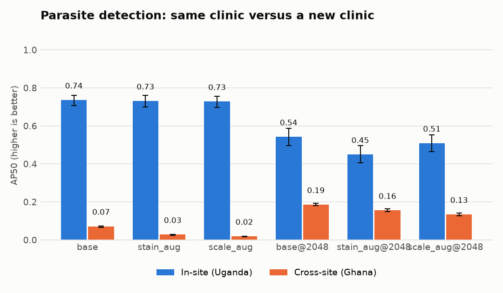
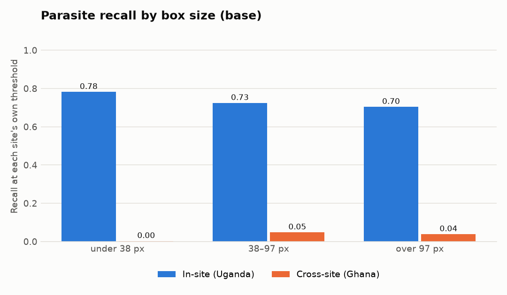
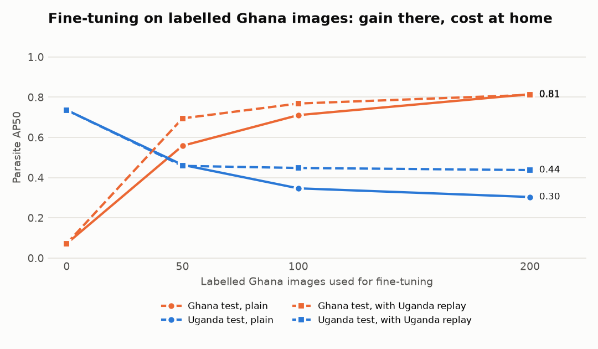
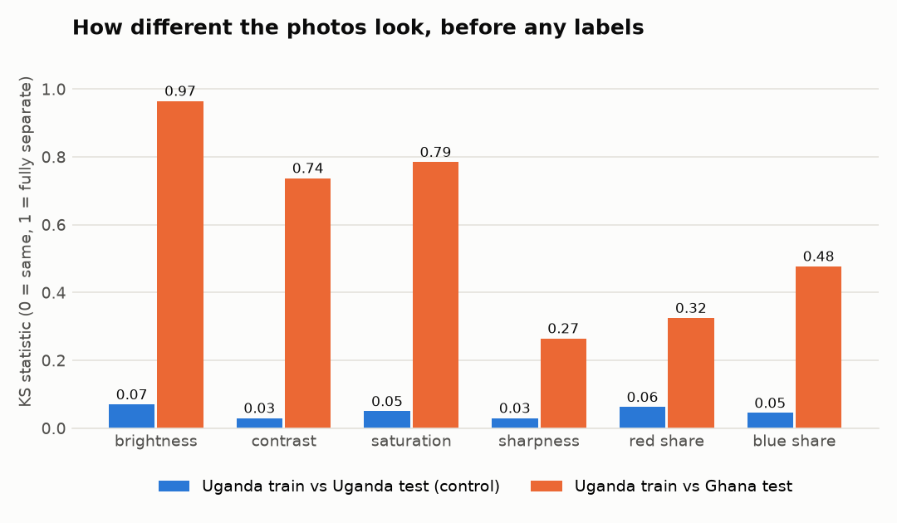

### Data after cleaning

| Site | Images found | No annotation | Duplicates | Unreadable | Usable | Parasite boxes | WBC boxes |
| --- | ---: | ---: | ---: | ---: | ---: | ---: | ---: |
| uganda | 3925 | 1178 | 0 | 0 | 2747 | 15837 | 7004 |
| ghana | 3045 | 0 | 0 | 0 | 3045 | 360880 | 16174 |

Split sizes: uganda_train 1921, uganda_val 413, uganda_test 413, ghana_test 2745, ghana_adapt_pool 200, ghana_calib 100, ghana_adapt_50 50, ghana_adapt_50_replay 100, ghana_adapt_100 100, ghana_adapt_100_replay 200, ghana_adapt_200 200, ghana_adapt_200_replay 400.

### Parasite detection, in-site and cross-site

A detection counts when it overlaps a labelled box by IoU ≥ 0.5. Intervals are 95% bootstrap intervals over images. The model selected on `uganda_val` is **base**.

- **As shipped**: threshold chosen on `uganda_val`, what a new clinic gets with no labels.
- **Recalibrated**: threshold chosen on `ghana_calib`, labelled ghana images that are never trained on and never in the test set. AP does not depend on the threshold; the other columns do.
- `name@size` is the same trained model run at a larger input size, with no retraining.

| Model | Test set | Threshold | AP50 (95% interval) | AP50-95 | Precision | Recall | F1 | Image sensitivity | Count error (MAE) |
| --- | --- | ---: | --- | ---: | ---: | ---: | ---: | ---: | ---: |
| base | uganda | 0.29 | 0.736 (0.71 to 0.76) | 0.290 | 0.670 | 0.738 | 0.702 | 0.971 | 1.95 |
| base | ghana, as shipped | 0.29 | 0.072 (0.07 to 0.07) | 0.019 | 0.763 | 0.001 | 0.002 | 0.074 | 119.03 |
| base | ghana, recalibrated | 0.01 | 0.072 (0.07 to 0.07) | 0.019 | 0.554 | 0.046 | 0.085 | 0.612 | 109.26 |
| stain_aug | uganda | 0.29 | 0.731 (0.70 to 0.76) | 0.292 | 0.648 | 0.746 | 0.694 | 0.974 | 2.26 |
| stain_aug | ghana, as shipped | 0.29 | 0.028 (0.02 to 0.03) | 0.008 | 0.756 | 0.000 | 0.001 | 0.029 | 119.10 |
| stain_aug | ghana, recalibrated | 0.01 | 0.028 (0.02 to 0.03) | 0.008 | 0.413 | 0.018 | 0.034 | 0.475 | 114.06 |
| scale_aug | uganda | 0.26 | 0.728 (0.70 to 0.76) | 0.289 | 0.650 | 0.745 | 0.694 | 0.981 | 2.31 |
| scale_aug | ghana, as shipped | 0.26 | 0.019 (0.02 to 0.02) | 0.010 | 0.494 | 0.000 | 0.001 | 0.039 | 119.04 |
| scale_aug | ghana, recalibrated | 0.01 | 0.019 (0.02 to 0.02) | 0.010 | 0.345 | 0.012 | 0.023 | 0.327 | 115.05 |
| base@2048 | uganda | 0.18 | 0.542 (0.50 to 0.59) | 0.176 | 0.543 | 0.572 | 0.557 | 0.961 | 2.78 |
| base@2048 | ghana, as shipped | 0.18 | 0.186 (0.18 to 0.19) | 0.060 | 0.826 | 0.014 | 0.028 | 0.361 | 117.13 |
| base@2048 | ghana, recalibrated | 0.01 | 0.186 (0.18 to 0.19) | 0.060 | 0.712 | 0.113 | 0.195 | 0.851 | 100.28 |
| stain_aug@2048 | uganda | 0.18 | 0.449 (0.41 to 0.50) | 0.133 | 0.459 | 0.566 | 0.507 | 0.977 | 3.08 |
| stain_aug@2048 | ghana, as shipped | 0.18 | 0.155 (0.15 to 0.16) | 0.044 | 0.780 | 0.013 | 0.025 | 0.332 | 117.23 |
| stain_aug@2048 | ghana, recalibrated | 0.01 | 0.155 (0.15 to 0.16) | 0.044 | 0.633 | 0.111 | 0.190 | 0.767 | 98.19 |
| scale_aug@2048 | uganda | 0.22 | 0.509 (0.46 to 0.55) | 0.157 | 0.528 | 0.562 | 0.544 | 0.936 | 2.76 |
| scale_aug@2048 | ghana, as shipped | 0.22 | 0.134 (0.13 to 0.14) | 0.037 | 0.707 | 0.019 | 0.036 | 0.295 | 116.03 |
| scale_aug@2048 | ghana, recalibrated | 0.01 | 0.134 (0.13 to 0.14) | 0.037 | 0.526 | 0.130 | 0.209 | 0.708 | 94.47 |

For base, AP50 goes from 0.736 in-site to 0.072 cross-site, a relative change of -90.3%.

### White blood cells and error analysis

For base. Ghana rows use the recalibrated threshold where one exists.

| Test set | WBC AP50 | WBC recall | Parasite false positives | of which on a labelled WBC |
| --- | ---: | ---: | ---: | ---: |
| uganda | 0.973 | 0.968 | 942 | 0 |
| ghana | 0.634 | 0.540 | 12107 | 31 |

The images with the most errors for base are saved in `reports/figures/errors/` (12 for uganda_test, 12 for ghana_test). Green = correct detection, red = false alarm, yellow = missed parasite.

### Few-shot adaptation to the new site

Ghana columns use each model's recalibrated threshold; Uganda columns use its home threshold. Replay mixes in the same number of Uganda training images.

| Labelled ghana images | Mode | ghana AP50 | ghana precision | ghana recall | ghana image sensitivity | ghana count error | uganda AP50 | uganda recall |
| ---: | --- | ---: | ---: | ---: | ---: | ---: | ---: | ---: |
| 0 | none | 0.072 | 0.554 | 0.046 | 0.612 | 109.3 | 0.736 | 0.738 |
| 50 | plain | 0.558 | 0.549 | 0.617 | 0.993 | 49.4 | 0.463 | 0.539 |
| 100 | plain | 0.711 | 0.654 | 0.731 | 1.000 | 27.1 | 0.347 | 0.443 |
| 200 | plain | 0.815 | 0.726 | 0.802 | 1.000 | 23.5 | 0.304 | 0.417 |
| 50 | replay | 0.695 | 0.617 | 0.726 | 0.999 | 40.0 | 0.458 | 0.458 |
| 100 | replay | 0.768 | 0.667 | 0.776 | 1.000 | 36.5 | 0.448 | 0.510 |
| 200 | replay | 0.811 | 0.705 | 0.810 | 0.999 | 28.5 | 0.438 | 0.473 |

### Baseline: patch classifier

Patch-level scores for a small CNN. They are not comparable with detection AP.

| Test set | Patches | AUROC | Average precision | F1 |
| --- | ---: | ---: | ---: | ---: |
| in-site | 7660 | 0.988 | 0.982 | 0.942 |
| cross-site | 20114 | 0.899 | 0.947 | 0.343 |

### Site shift measured without labels

A classifier given only simple image statistics separates the two sites with AUROC 0.996 (control between two splits of the training site: 0.479; 0.5 means it cannot tell them apart). 99% of cross-site test images fall outside the training range on at least one statistic (in-site: 13%).

